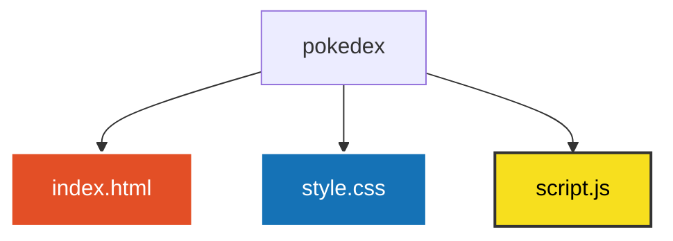

# Pokédex 🔴⚡


> Uma Pokédex interativa desenvolvida em JavaScript Vanilla que consome dados em tempo real da PokéAPI, exibindo sprites animados e informações dos Pokémon.

---

## 💻 Sobre o Projeto

A **Pokédex Web** é uma aplicação front-end que simula a Pokédex dos clássicos jogos de Pokémon. Ela permite pesquisar qualquer Pokémon pelo **nome** ou **número de identificação (ID)**, além de permitir a navegação sequencial pelos botões da interface.

O projeto se destaca pelo uso de requisições assíncronas com `async/await` e `fetch` para consumir a [PokéAPI](https://pokeapi.co/), exibindo os sprites animados dos Pokémon da 5ª Geração (*Black & White*) com *fallback* automático para sprites estáticos.

---

## ⚙️ Funcionalidades

- **Pesquisa Inteligente:** Busca de Pokémon por nome ou ID, ignorando letras maiúsculas/minúsculas (`toLowerCase`).
- **Navegação Interativa:** Botões "Anterior" e "Próximo" para percorrer a Pokédex sequencialmente.
- **Sprites Animados:** Exibição de GIFs animados dos Pokémon em tempo real.
- **Tratamento de Erros:** Exibição de estado de carregamento (*Carregando...*) e mensagem de erro amigável (*Não encontrado*) caso o Pokémon não exista.
- **Interface Fiel:** Layout estilizado em CSS para simular o design físico da Pokédex clássica.

---

## 🛠️ Tecnologias Utilizadas

- **HTML5:** Estruturação da Pokédex, formulário de pesquisa, botões de controle e contêineres de imagem/texto.
- **CSS3:** Estilização responsiva, posicionamento absoluto dos elementos na tela da Pokédex e manipulação de layout.
- **JavaScript (ES6+):**
  - **Consumo de API:** Requisições HTTP dinâmicas usando `fetch` e `async/await`.
  - **Manipulação do DOM:** Atualização dinâmica de imagens, textos e limpeza automática do campo de input.
  - **Manipulação de Eventos:** Tratamento do envio do formulário (`submit`) e cliques dos botões (`click`).

---

## 🌎 Teste meu projeto no seu navegador! 

- **Pokédex:** [VEJA ESTE PROJETO NO SEU NAVEGADOR!](https://hubpokedex.netlify.app)

---

## 🚀 Como Executar o Projeto Localmente

### Pré-requisitos
- Um navegador web moderno (Google Chrome, Firefox, Edge, etc.).
- [Git](https://git-scm.com) instalado na máquina.
- Um editor de código como o [VS Code](https://code.visualstudio.com/) (opcional).

### ☕ Passo a Passo

1. **Clone este repositório:**
   ```bash
   git clone https://github.com/AliceSilva2012/pokedex.git
   ```

2. **Acesse a pasta do projeto:**
   ```bash
   cd pokedex
   ```

3. **Execute a aplicação:**
   - Dê um duplo clique no arquivo `index.html` para abri-lo no navegador, ou
   - Clique com o botão direito no `index.html` e selecione **Open with Live Server**.

---

## 📁 Estrutura do Arquivo



